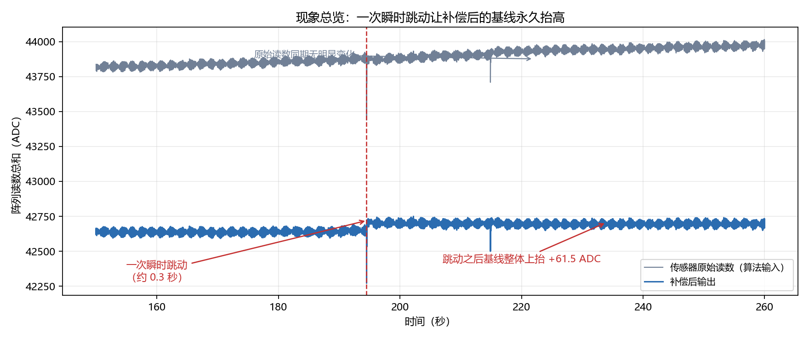
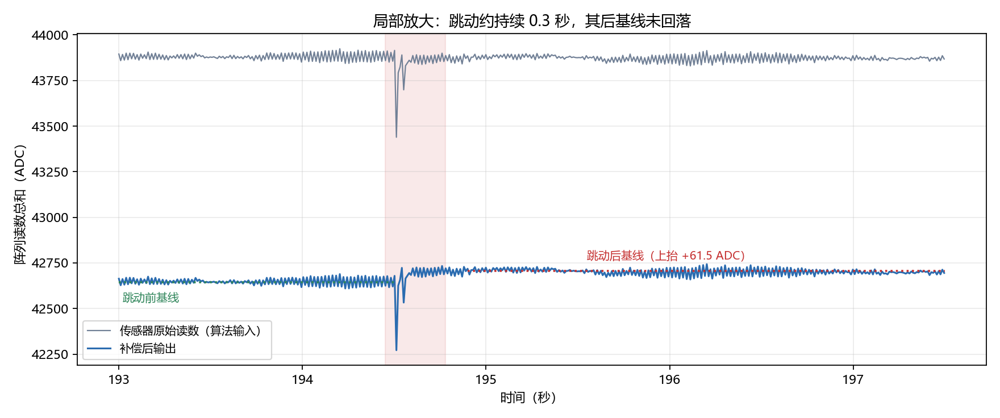
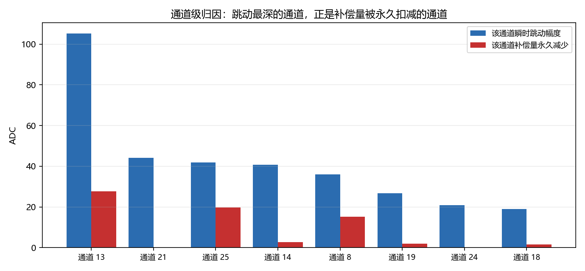
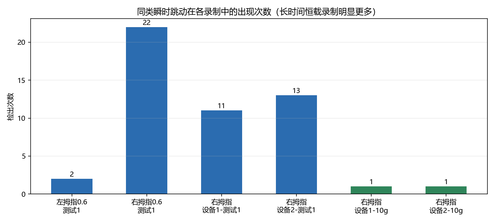
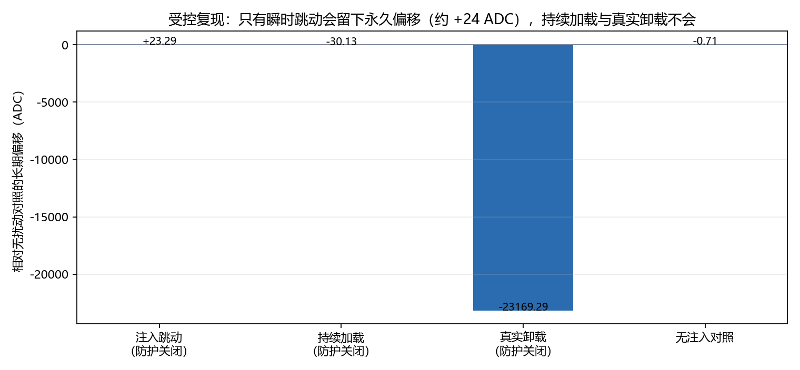
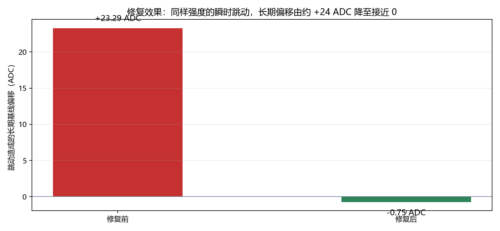

# 触觉阵列时漂补偿：瞬态干扰导致基线偏移的问题说明

**文档类型**：问题分析与解决方案说明
**数据来源**：左拇指指腹恒载录制（2026-10-14，长时间恒定加压）
**版本**：K10 瞬态防护
**日期**：2026-10-14

---

## 一、结论摘要

| 项目 | 内容 |
|---|---|
| **现象** | 一次约 0.3 秒的瞬时跳动，使补偿后的读数基线**永久抬升 61.5 ADC 且不再回落** |
| **对照** | 同一时段的传感器原始读数**没有任何变化**（跳动前后差值 0.0 ADC） |
| **影响量级** | 61.5 ADC。按项目既有的粗略比例（1000 ADC ≈ 1 N）折算约 0.06 N；**相当于 10 g 级目标信号（约 100 ADC）的六成** |
| **根本原因** | 算法把"瞬时跳动"误判为"载荷已卸除"，据此执行了一次**基线修正**，而该修正不会自动撤销 |
| **解决方式** | 增加一层**瞬态识别保护**：只有"持续保持"的电平变化才被认定为真实载荷变化 |
| **验证结果** | 同样的跳动，长期偏移由 **+24 ADC 降至接近 0**；对真实加载、真实卸载、小幅度卸载的长期结果**无影响** |

---

## 二、问题现象

在左拇指指腹的恒载录制中，第 **194.5 秒**附近出现了一次瞬时跳动（持续时间约 0.3 秒）。
这次跳动造成了两个后果：

**1. 原始读数完全正常**



图中灰线为传感器原始读数，蓝线为补偿后输出。可以看到：

- 原始读数在整段时间内平滑稳定，跳动前后**没有任何台阶变化**（实测差值 0.0 ADC）；
- 补偿后输出在跳动发生的位置出现一个下探尖峰，**随后基线整体上抬 61.5 ADC 并保持不变**——它没有回到跳动前的水平。

**2. 基线抬升是永久性的**



放大后可清楚看到：跳动前基线（绿色虚线）与跳动后基线（红色虚线）之间存在一个稳定的台阶。
事件前后原始读数无变化，说明这个台阶**不是物理载荷变化造成的，而是补偿结果自身产生的偏差**。

按 1000 ADC ≈ 1 N 的粗略比例，该台阶约相当于 0.06 N 的长期读数误差；
相对于 10 g 级（约 100 ADC）的目标检测信号，这是**约六成幅度**的固定偏差。
---

## 三、问题原因

### 3.1 直接原因

补偿算法的正常工作依赖一个判断：**当前读数是"仍有载荷"还是"已经卸除"**。
算法在运行中持续维护一个"基线基准"，并在判定为卸除状态时，把当前电平作为新的基准。

这次瞬时跳动的形态是"快速下探后回落"，事件持续时间很短（0.3 秒）。
算法在极短时间内看到读数跌破了原有基准，**误认为载荷已经被卸除**，
于是执行了一次基线修正——而修正之后，跳动的实际形态早已恢复，算法却把新的错误电平保留了下来。

由于修正一旦完成就不会自动回退，这个偏差便长期留在输出中。

### 3.2 通道级证据

对全部通道逐一分区统计后可以看到明确的对应关系：



跳动最深的数个通道，**恰好就是补偿量被永久扣减的通道**（三个主要通道合计变化量与总量吻合）。
这排除了"整体漂移"或"随机噪声"的解释，确认是这次跳动直接导致的状态改变。

### 3.3 为什么此前未被发现

同类瞬时跳动在不同测试中的出现次数差异极大：



| 测试类型 | 检出次数 |
|---|---:|
| 10 g 反复增减荷载（设备1 / 设备2） | 各 1 次 |
| 长时间恒载录制 | 2 ~ 22 次（不同录制差异较大） |

**这解释了为什么该问题在短时的 10 g 测试中不明显、却在长时间恒压测试中凸显**：
长时间加压过程中，这类干扰出现得更频繁，每一次都可能留下一份不会消失的偏差，逐渐累积。

---

## 四、解决方案

### 4.1 设计思路

问题的关键在于：**瞬时跳动与真实载荷变化在数值上相似，但物理含义完全不同**。

- **瞬时跳动**：电平短暂偏离后**回到原来的水平**；
- **真实载荷变化**：电平偏移后**稳定停留在新的水平**。

因此解决方案的核心不是"过滤掉大幅度的变化"（那会误伤真实操作），
而是**依据"变化是否持续保持"来区分二者**：

```
判定规则（示意）
  电平发生偏移
    ├─ 短暂偏离后回到原水平  → 判为干扰，不作为基线修正依据
    └─ 偏移后稳定保持在新水平 → 判为真实变化，正常处理
```

### 4.2 三条设计原则

1. **保护的是"形态"，不是"幅度"**
   不设置"超过某个幅度就拒绝"的门槛，避免小幅度真实操作被误伤。

2. **必须持续保持才算真实变化**
   任何电平变化都需要在短时间内持续保持，才被确认为新的基准；
   抖动、毛刺、接触干扰这类"来了又走"的变化不会被采纳。

3. **大幅度真实卸载仍立即响应**
   对明显的真实卸载（例如手指抬起），判定不受保护层延迟影响，保证卸载响应速度。

### 4.3 功能定位

该保护层是**在原有补偿逻辑之上新增的一层识别与保护机制**，不改变原有补偿算法的行为：

- 可作为**可开关选项**启用；
- 关闭时与原有算法结果**完全一致**；
- 不引入新的外部依赖，计算开销可忽略。

---

## 五、验证结果

### 5.1 受控复现与修复效果

将现场录到的同一条跳动波形提取出来，在受控条件下注入并对比：



- **只有瞬时跳动**会留下永久偏移（约 +24 ADC）；
- **持续加载**与**真实卸载**都不会留下永久偏移。

这确认了问题的触发条件，也说明保护层只需针对这一种形态。

加入保护后的效果：



同样的跳动强度下，长期基线偏移由 **+24 ADC 降至接近 0**。

### 5.2 对正常功能无影响

保护层开启后，对真实操作的影响经实测如下：

| 验证项 | 结果 |
|---|---|
| 持续加载（+2000 ADC，20 秒） | 长期结果与原来**完全一致** |
| 真实卸载（卸载 90%） | 长期结果与原来**完全一致** |
| 小幅度真实卸载（每通道 20 ~ 400 ADC） | 长期稳态差异 **0**；仅卸载瞬间有约 17 ADC 的短暂差异，5 秒内收敛 |
| 长时间恒载录制的漂移指标 | 变化 ≤ 0.7% |
| 小信号（10 g 级）保留能力 | **无变化** |

### 5.3 结论

- 该保护层**有效解决**了瞬时干扰导致的基线永久偏移；
- 对真实载荷变化、卸载响应、小信号检测**均无实质影响**；
- 关闭保护层时，行为与现有算法**完全一致**，可以安全地作为可选功能引入。

---

## 六、建议

1. **建议在固件中引入该保护层**，并保留开关，便于现场对照验证。
2. **建议在长时间恒压场景下优先启用**——这类场景中干扰出现频率高，累积影响明显。
3. **保护参数需按现场标定**：确认时长等参数与传感器噪声水平、实际操作速度相关，
   建议在不同传感器部位上分别确认后再定版。
4. 后续若补充"带操作时刻标记"的测试数据，可进一步量化保护层对真实小载荷操作的响应延迟。

---

## 七、附：本文档涉及的数据与图件

| 图件 | 说明 |
|---|---|
| 图 1 现象总览 | 原始读数与补偿输出的对比，显示跳动位置与基线抬升 |
| 图 2 局部放大 | 事件前后基线的台阶对比 |
| 图 3 通道影响 | 跳动幅度与补偿量变化的通道级对应关系 |
| 图 4 受控复现 | 不同扰动形态是否造成永久偏移 |
| 图 5 修复对比 | 保护层启用前后的长期偏移对比 |
| 图 6 出现次数 | 同类跳动在不同测试中的分布 |

所有图件均由现场录制数据直接计算生成，可在本地复现。
